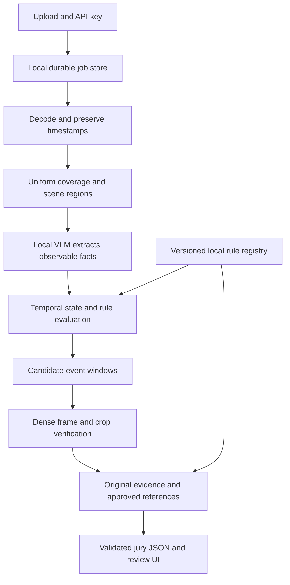

# ForteBank video analysis architecture

Date: 17 October 2026. Status: proposed architecture; model accuracy and latency have not yet been benchmarked on the supplied videos.

## Recommendation

Build a fully local pipeline in which a vision-language model (VLM) extracts observable facts, a small temporal rule engine combines them, and targeted frame inspection verifies candidate events. Generate explanations and normative references from verified observations and a curated rule registry.

The central insight from [the violation taxonomy](violation_taxonomy.md) is that labels depend on scene state and context. Walking away occurs in both positive and control clips. Cash remaining on the desk or a visibly active laptop can distinguish otherwise similar sequences.

Implement a simpler structured whole-video VLM baseline first. Keep the hybrid only if its additional stages improve detection, evidence, or localization within the same compute budget.

## Evidence and constraints

This analysis uses the supplied `Кейс_ForteBank.docx`, `open_labels.xlsx`, the taxonomy, the current application code, and primary research sources. The case document and labels are supplied separately from this repository. Two research subagents investigated related papers; a third reviewed the proposed normative mappings.

The supplied labels cover 42 videos: 22 positive and 20 negative. The taxonomy assigns strong visual confidence to six positives, provisional interpretations to four, and leaves twelve unresolved. Strong visual confidence does not necessarily mean strong normative support.

| Case requirement | Architectural consequence |
| --- | --- |
| Local inference; no cloud AI calls or transfer of video descriptions to cloud AI | Package model weights and dependencies; processing must work without outbound internet |
| Public UI and API | Expose a team-controlled service through HTTPS while keeping inference local |
| Silent `.mov` videos, approximately 10–145 seconds | Use visual processing; preserve actual media timestamps |
| Result within five minutes | Budget queueing, decoding, inference, evidence generation, and serialization together |
| Multiple possible violations per video | Return event lists; merge repeated alerts without collapsing distinct occurrences |
| Evidence frames and timecodes | Retain links from observations to original decoded frames |
| New camera angle and potentially unseen types | Avoid fixed-coordinate-only processing and an exclusively closed-set classifier |
| No face recognition or identification | Use anonymous within-clip tracks and tentative spatial roles |
| No bank system access; human review remains necessary | Do not infer authorization, transaction correctness, or hidden system state as fact |

The first four scoring categories—detection, localization, classification, and rule justification—account for 70 points. Reliable evidence and rule interpretation are central to the product, not optional explanation features.

## Architecture alternatives

| Approach | Strength | Main risk in this dataset | Decision |
| --- | --- | --- | --- |
| Whole-video VLM to event JSON | Minimal implementation and flexible descriptions | Small objects disappear; generated times and explanations can be unsupported | Required baseline |
| Detection, tracking, and rules | Explicit spatial and temporal decisions | Tiny cash objects, bag ambiguity, screen state, and changed viewpoints | Add components selectively |
| Learned video anomaly detector | Can learn temporal patterns with sufficient representative data | Tiny dataset, ambiguous positive labels, scene shortcuts, and mismatch between unusual and prohibited behavior | Defer |
| VLM facts, temporal rules, and crop verification | Combines flexible perception with inspectable decisions | More stages and propagation of perception errors | Preferred hypothesis to validate |

Do not train a detailed typed classifier on guessed explanations for the twelve unresolved positives. More machinery cannot recover a policy definition that has not been established.

## Proposed processing flow



### Decode and retain evidence

Decode locally, apply rotation metadata, and retain presentation timestamps. Do not assume that every video has exactly 30 FPS or derive times exclusively from frame number divided by an assumed frame rate.

Maintain a modest-resolution sequence for context and original-resolution frames for object inspection and evidence. As an initial experiment, sample at one frame per second and use overlapping eight-second windows with a six-second stride. Increase sampling around transitions and uncertain boundaries. These are proposed starting settings, not validated parameters.

Always inspect the beginning and end. A clip may start with an unattended workstation, and static belongings may generate no useful motion signal. Maintain coverage across the entire clip even when event proposals are available.

### Establish regions for each video

Identify the desk, screen, safe, doorway, and staff-side workspace where visible. Fixed crops are useful for initial experiments on the existing view, but should not determine the final architecture.

[Grounding DINO](https://huggingface.co/IDEA-Research/grounding-dino-tiny) is a candidate for locating relevant regions. Benchmark it before making it mandatory. Missing an object detection must not automatically produce a negative verdict: a broader desk crop may still expose cash that the detector missed.

Keep full-frame context with each crop. A cash crop alone cannot establish whether the cashier is present. If region localization is uncertain, widen the inspection area and retain that uncertainty.

### Extract facts with explicit uncertainty

Use a small vocabulary rather than unrestricted captions:

```text
cash_like_object_on_desk: true / false / unknown
cashier_at_workstation: true / false / unknown
client_at_service_position: true / false / unknown
person_enters_staff_side: true / false / unknown
personal_belongings_on_desk: true / false / unknown
food_or_drink_visible: true / false / unknown
screen_state: locked / active_application / dark / unreadable
```

Each observation needs a timestamp, region or anonymous track, visibility assessment, and supporting frame ID. Model confidence is a score to validate, not automatically a calibrated probability.

Separate observation from interpretation. A green bag can be visible without its contents being known. A person can enter behind the desk without their authorization being established. A lit screen is not necessarily an unlocked screen. Role assignments must remain tentative when a clip lacks enough context.

### Compose temporal conditions

Start with ordinary application code over timestamped observations. A graph database or general-purpose reasoning framework is unnecessary.

```text
candidate unattended cash:
    cash-like object remains on the desk
    AND cashier departs or is visibly absent
    AND the relevant desk region remains observable
```

This identifies a candidate visual condition. Applying a particular storage rule additionally requires its transaction context and scope.

Represent states, transitions, context, and recovery separately. Cash presence is a state; departure is a transition; ongoing customer service is context; return or securing the cash can resolve the event. Merge repeated detections of a persistent condition, but preserve later recurrences.

Temporal smoothing may reduce flicker. It must not invent policy: requiring consistent observations is an engineering choice, not evidence that a regulation permits several seconds of unattended cash. Occlusion is unknown, not proof that an object disappeared.

### Verify and localize candidates

Inspect a short before/during/after sequence and native-resolution regions. Test alternatives: paper mistaken for cash, an off-crop cashier, a lock screen mistaken for an application, cash removed before departure, or an object hidden by occlusion.

A second prompt to the same model is not independent confirmation. Verification earns its cost through better pixels, additional temporal context, and explicit checks against contradictory evidence.

Store an internal onset interval, refine it with denser frames, and choose an actual supporting frame timestamp for the API. Have the model select frame IDs; calculate timestamps in application code. Do not accept invented decimal times.

Use one to three original evidence images showing context, onset, and persistence when useful. Keep UI annotations distinguishable from the original image. The dataset mixes action-start and consequence timestamps, so evaluate against both supplied labels and adjudicated visible onset; do not silently rewrite the official labels.

## Normative interpretation

Visual certainty and rule applicability must be stored separately. The source review used indexed official text; a complete effective-version audit remains outstanding. Recording dates and applicable versions should be established before normative conclusions are finalized.

| Type | Proposed treatment |
| --- | --- |
| T1: cash on desk | Prioritize. Paragraph 20 distinguishes current-customer cash from previously accepted cash requiring storage; visibility alone is insufficient |
| T2: personal belongings | Strong candidate when cash-unit context and object identity are clear; check ownership ambiguity and permitted-item exceptions |
| T3: food or drink | Observable fact; the reviewed belongings clause does not independently establish an explicit food/drink ban |
| T4: person behind desk | Describe visible entry; the cited isolation provision does not establish lack of authorization |
| T5: unlocked laptop on departure | Detect screen state, but the cited inactivity requirement does not establish an immediate-lock-on-departure rule |
| T6: departure during service | Requires evidence of ongoing applicable service and departure; an empty desk or waiting person alone is insufficient |

Cash, belongings, and service provisions are in [NBRK No. 231](https://old.adilet.zan.kz/rus/docs/V1900019680). The personal-item exceptions are addressed by [the 2025 amendment](https://old.adilet.zan.kz/rus/docs/V2500037429). Cash-unit isolation is addressed by [No. 14](https://old.adilet.zan.kz/rus/docs/V2000020075). The taxonomy's separate No. 231 paragraph 75 mapping was not independently verified and remains provisional.

For T5, [No. 53, paragraphs 71–72](https://old.adilet.zan.kz/rus/docs/V2600038336/compare) concerns automatic session termination or locking after inactivity exceeding 30 minutes, with qualifications. These short clips cannot establish that condition merely through a visible desktop. Retain the detector, mark the mapping unresolved, and obtain the intended public rule before presenting it as rule-supported. This may create a real tradeoff against the supplied positive labels; do not conceal it with an invented legal explanation.

Maintain a small local registry containing rule ID, document title, clause, source URL, effective version, scope, required facts, exceptions, supported event types, and explanation template. Direct lookup is sufficient initially. The taxonomy references `rules_kb.json`, but that file was not found during workspace inspection and remains a dependency to supply.

Do not let the model invent references or browse regulations while processing video. Keep unresolved visual observations distinct from supported possible violations.

## Unseen types

Alongside explicit taxonomy questions, allow proposals for other concrete observable events. Verify each against pixels and the local rule registry. New combinations of known facts may fit an existing rule; an unfamiliar event with no defensible mapping remains an observation requiring review.

Unusual appearance alone must not trigger a violation. New clothing, a different camera angle, or an unfamiliar bag can change an anomaly score without changing compliance. Open-ended descriptions do not make the system capable of checking unknown policies.

## Models and compute

Compare [Qwen2.5-VL-7B-Instruct](https://huggingface.co/Qwen/Qwen2.5-VL-7B-Instruct) and [Qwen3-VL-8B-Instruct](https://huggingface.co/Qwen/Qwen3-VL-8B-Instruct) as local candidates. Both official model cards specify Apache-2.0. Check the exact shipped weights and dependency licenses as part of packaging.

Choose using matched-control discrimination, tiny-object visibility, structured-output reliability, and end-to-end latency. Neither is established as the best model for this corpus.

Hardware is unspecified. A planning scenario is one GPU with approximately 24–48 GB VRAM; lower capacity may require quantization and stricter visual-input budgets. Weight size alone is insufficient: visual tokens, runtime overhead, and concurrency also consume memory. Avoid multiple large models initially; use templates for final explanations where possible.

### Five-minute budget

The deadline includes queueing, decoding, coverage, verification, evidence, and serialization. Keep models loaded and warm them before accepting jobs.

The following is an illustrative budget for a 145-second clip, not a performance measurement:

| Work | Assumption |
| --- | ---: |
| Decode and establish regions | 25 seconds |
| 24 coverage windows at 3 seconds each | 72 seconds |
| 8 verification windows at 12 seconds each | 96 seconds |
| Evidence and JSON | 10 seconds |
| Queue allowance | 30 seconds |
| Remaining margin | 67 seconds |
| Total | 300 seconds |

Eight verification windows are a workload assumption, not a limit permitting extra events to be discarded. Measure candidate counts, the longest videos, memory peaks, and concurrent submissions. Reduce unnecessary work or add capacity based on measurements.

Do not disguise a timed-out or incomplete analysis as `no_violation`. A failed job and a successfully analyzed video without supported candidates are different outcomes.

## Application and deployment

The current [AI route](apps/api/src/routes/ai.ts) calls Workers AI, and [the Worker configuration](apps/api/wrangler.jsonc) contains a remote AI binding. This inference path conflicts with the case restriction for processing videos, frames, or their descriptions.

Use a team-controlled host with:

- The existing React interface served locally.
- One API handling upload, job status, and the jury contract.
- A durable local job table and filesystem storage.
- A local inference worker with installed model weights.
- A reverse proxy exposing HTTPS to the jury.

Reuse UI and validation work. Either adapt Hono to a local runtime or expose the jury endpoints directly through the local Python service; avoid duplicate orchestration layers without a concrete need. SQLite and filesystem storage are sufficient for the first single-host implementation. Remove runtime dependence on remote D1 and cloud AI from the offline deployment path.

Verify the complete processing path with outbound networking disabled after installation. Inbound public access does not require outsourced inference. Do not send submitted videos, frames, or descriptions to external AI services or reuse jury videos for training.

### Jury contract

- `POST /api/v1/analyze`: `.mov` upload in multipart field `file`, returning `job_id`.
- `GET /api/v1/jobs/{job_id}`: `processing`, `done`, or `failed`.
- Authenticate requests with `X-API-Key`.
- Completed results use `violation` or `no_violation`, with an event list.
- Each event has a type, timecode, description, and one to three base64 JPEG evidence frames.

The example contract has no dedicated normative-reference field despite the requirement for references. Include the document, clause, and URL in `description` for compatibility, and retain richer structured fields internally.

Keep uncertainty internally without introducing an undocumented third verdict. A negative result means no supported candidate was detected in the analyzed material, not that every banking rule has been verified. Show coverage limitations in the review interface.

## Research and transfer limits

These papers address related surveillance, temporal grounding, and procedural-error problems. None establishes performance on banking compliance or predicts the score on this dataset.

| Paper | Useful mechanism | Transfer limitation |
| --- | --- | --- |
| [ASK-HINT, WACV 2026](https://openaccess.thecvf.com/content/WACV2026/papers/Zou_Unlocking_Vision-Language_Models_for_Video_Anomaly_Detection_via_Fine-Grained_Prompting_WACV_2026_paper.pdf) | Compact, concrete visual questions with a frozen VLM | Crime benchmarks; explanations are not independently verified evidence |
| [Training-free Video Temporal Grounding, ECCV 2024](https://arxiv.org/html/2408.16219v1) | Static states, transitions, and temporal relations | Original implementation uses GPT-4 Turbo; transfer the decomposition into local rules |
| [Action Effect Modeling](https://arxiv.org/html/2512.03474v1) | Inspect outcomes through object states and spatial relations | Trained and distilled pipeline; borrow its representation rather than assuming tiny-data feasibility |
| [LAVAD, CVPR 2024](https://arxiv.org/html/2404.01014v1) | Temporal aggregation and visual refinement of caption-based anomaly scoring | Captions may omit the small object or screen state that determines the label |
| [Holmes-VAD](https://arxiv.org/html/2406.12235v1) | Select candidate moments before expensive explanation | Substantial training data; a crime-trained proposal model may miss bank-specific states |
| [ZeProM, June 2026 preprint](https://arxiv.org/html/2606.21579v1) | Structured VLM baseline for zero-shot procedural mistakes | Headline configuration uses a very large model on four H100 GPUs; runtime and accuracy do not transfer |

The proposed design combines concrete questions, explicit temporal composition, and inspection of action outcomes. It does not reproduce these papers' full systems. Training-free does not automatically mean offline-compatible or commercially licensed.

## Evaluation

Maintain three annotation layers: supplied binary label and timestamp; independently observed visual facts; proposed type and normative mapping. Keep unresolved positives in binary evaluation, but do not use guessed explanations as trusted type labels.

Group near-duplicate recordings and related staged scenarios into the same validation fold. Never split adjacent frames across training and validation. Check the two supplied video directories for duplicate content before counting examples. Normalize filenames carefully because both Latin `X` and Cyrillic `Х` occur.

Compare under a common compute budget:

| Experiment | Question |
| --- | --- |
| Structured whole-video VLM | How good is the simplest approach? |
| Concrete fact questions | Does explicit perception improve decisions? |
| Facts plus temporal rules | Do relationships distinguish matched controls? |
| Added crop verification | Does extra processing reduce meaningful errors? |
| Added detector or tracker | Does the component justify its cost? |

Report video confusion counts, event precision and recall, type results on trusted annotations, timestamp error, evidence relevance, citation correctness, duplicate alerts, latency, memory, and failed jobs. Separate well-understood from unresolved examples. Forty-two clips cannot support precise generalization claims.

Make X-28/X-29 and X-26/X-27 mandatory regression pairs. Include first-frame-only and shuffled-frame baselines to expose scene and timing shortcuts. Add a genuine second-camera recording: cropping and perspective augmentation cannot prove robustness to different visibility and occlusion.

The request for very few false positives and no missed violations is an objective, not a guarantee a threshold can deliver. Report the observed tradeoff and review burden.

## Implementation order and decision gates

1. Resolve unexplained positives and establish trusted facts, types, and evidence annotations. Verify by independently reviewing the decisive frames and matched controls.
2. Implement the local upload/job/result path with a structured VLM baseline. Verify the exact jury schema, authentication, multiple events, and original evidence frames.
3. Benchmark the longest videos on the actual GPU. Verify total latency including queue time and repeated/concurrent requests.
4. Add temporal composition for supported categories, prioritizing T1. Verify improvement on matched controls without increasing unexplained false positives.
5. Add crop verification and onset refinement. Verify evidence correctness and timestamp improvement.
6. Add detection or tracking only for measured failures. Verify the incremental benefit against its latency and implementation cost.
7. Validate the changed camera angle and offline deployment. Verify operation with outbound networking disabled and all model artifacts preinstalled.

The first decision gate is whether a local model can distinguish the matched controls, identify the decisive object or screen state, and produce verifiable evidence within the deadline. That result determines whether the next investment belongs in perception, temporal reasoning, or label clarification.
